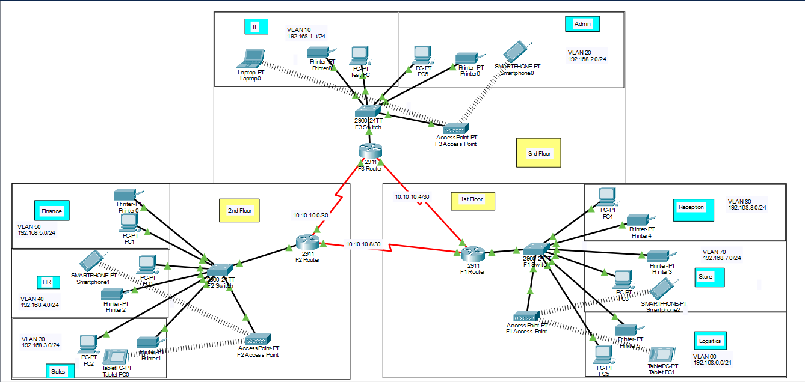
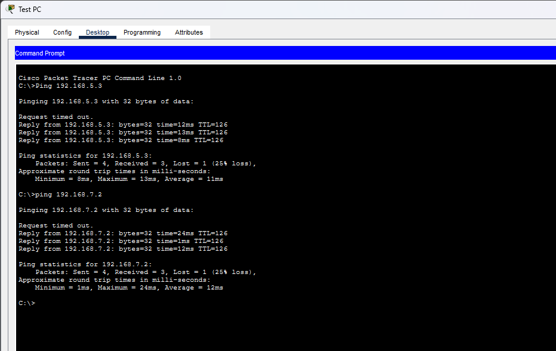
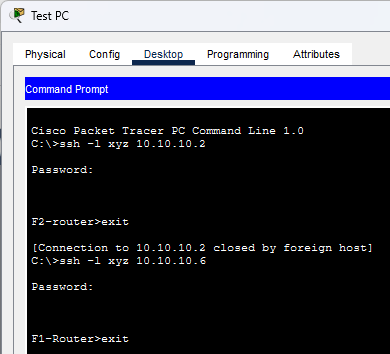

# Modern Hotel Network (Cisco Packet Tracer)

A three-floor hotel network built in Cisco Packet Tracer, with one router and one switch per floor. The routers are connected by serial DCE cables and share routes using OSPF.

## Topology



| Floor | Router | Switch | Access Point | Departments |
|-------|--------|--------|--------------|-------------|
| 1st | F1-Router (2911) | F1 Switch (2960) | F1 Access Point | Reception, Store, Logistics |
| 2nd | F2-Router (2911) | F2 Switch (2960) | F2 Access Point | Finance, HR, Sales |
| 3rd | F3-Router (2911) | F3 Switch (2960) | F3 Access Point | Admin, IT |

Each department has a printer, and wireless devices (laptops, phones, tablets) connect through the access point on each floor.

## Features

- Each department is in its own VLAN
- Inter-VLAN routing using router-on-a-stick
- OSPF routing between the three routers
- DHCP on each router for its own floor
- Wi-Fi on every floor
- SSH remote login on all routers
- Port security (sticky, shutdown) on the IT switch port Fa0/1 for Test-PC

## Addressing

### Router links

| Link | Network |
|------|---------|
| F3 - F2 | 10.10.10.0/30 |
| F3 - F1 | 10.10.10.4/30 |
| F2 - F1 | 10.10.10.8/30 |

### Departments (mask 255.255.255.0)

| Floor | Department | VLAN | Network | Gateway |
|-------|------------|------|---------|---------|
| 1 | Reception | 80 | 192.168.8.0/24 | 192.168.8.1 |
| 1 | Store | 70 | 192.168.7.0/24 | 192.168.7.1 |
| 1 | Logistics | 60 | 192.168.6.0/24 | 192.168.6.1 |
| 2 | Finance | 50 | 192.168.5.0/24 | 192.168.5.1 |
| 2 | HR | 40 | 192.168.4.0/24 | 192.168.4.1 |
| 2 | Sales | 30 | 192.168.3.0/24 | 192.168.3.1 |
| 3 | Admin | 20 | 192.168.2.0/24 | 192.168.2.1 |
| 3 | IT | 10 | 192.168.1.0/24 | 192.168.1.1 |

## How It Works

- Each floor switch holds the VLANs for that floor, and its port to the router is a trunk.
- Each router has one subinterface per VLAN, which acts as the gateway for that VLAN.
- OSPF (area 0) runs on all routers, so every floor learns the other floors' networks.
- Each router hands out IP addresses to devices on its floor using DHCP.
- SSH is enabled on the routers, and remote login is tested from Test-PC.

## Testing

- Devices on different floors and VLANs can ping each other.
- Wireless devices get an IP address automatically and reach other floors.
- SSH login from Test-PC to the routers works.
- Plugging another device into the IT switch's Fa0/1 shuts the port down.




## Repository Contents

```
.
├── README.md
├── network_design.pkt
└── images/
    ├── topology.png
    ├── ping-test.png
    └── ssh-test.png
```

## How to Open

Open `network_design.pkt` with Cisco Packet Tracer.
